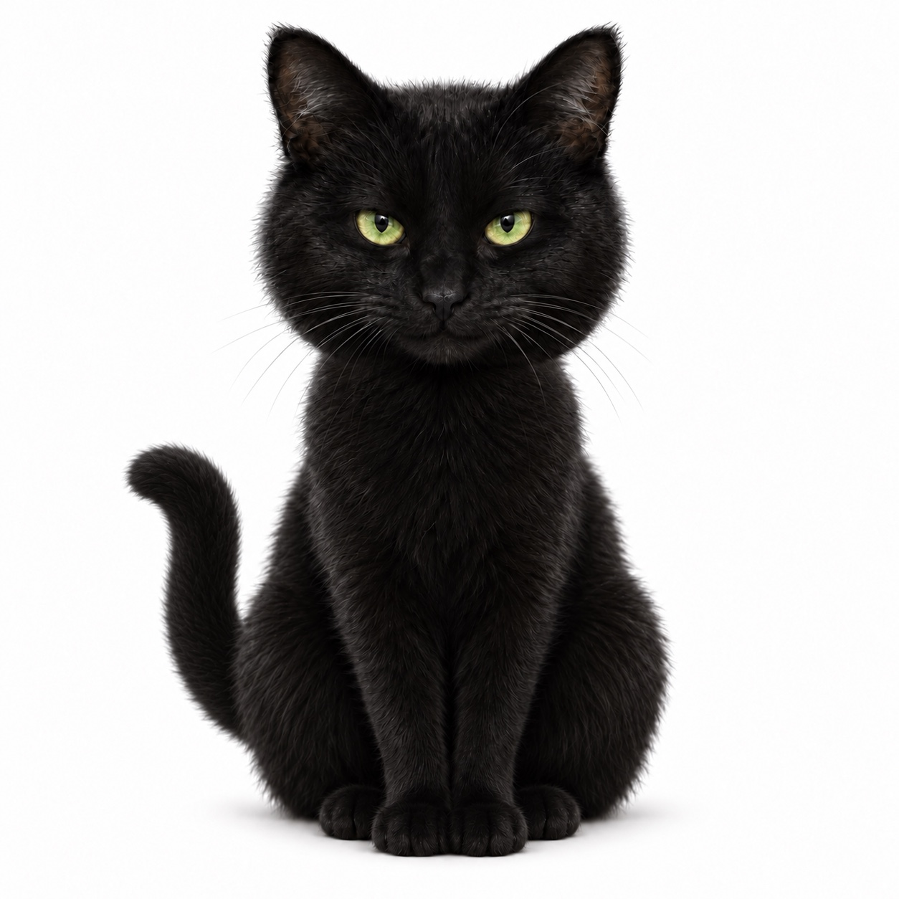

# Black Cat design reference

The user selected **Graphical design for black cat project** as the canonical visual reference on 16 September 2026. The original folder now sits inside **linux usb project**, preserving its identity and all 18 files.

## Source of truth

- Folder: `/linux usb project/Graphical design for black cat project`
- Stable folder identifier: `6aa9de3e85348191a41378f44736d626`
- [Exact source inventory and SHA-256 identities](source-manifest.json)
- [Original brand notes, copied without changes](brand-notes-2026-09-16.txt)
- [Original cat reference, copied without changes](black-cat-reference.jpeg)

Use the front-facing seated black cat, vivid green eyes, and tail curled upward on the viewer's left. Preserve the recognizable cat rather than inventing a replacement mascot. The folder's welcome screen and other variants guide future layout and artwork; their presence does not select every variant for production.

## Brand and interface rules

The canonical tagline is **Stealth. Intelligence. Independence.** The welcome-screen concept still embeds “Freedom”; this is historical artwork, not the current wording. Preserve the original and correct the wording when creating a derived production asset.

- Stealth: users deliberately control their visibility, including voluntary public transparency.
- Intelligence: help users understand, create, explore and make their own decisions.
- Independence: portable project data, local usefulness, service choice and recoverable ownership.
- Use dark black/charcoal surfaces and green accents consistent with the supplied welcome concept; do not place critical text over busy fur or glows.
- Security findings remain readable and specific. Branding, green colouring and attractive screens never imply an unproven security result.
- Keep implemented controls distinguishable from previews. Unimplemented module permissions remain labelled as previews.

## Engineering integration

All subsequent visual work on the boot experience, desktop/session panel, Console and project viewer must consult this folder and the brand notes first. Record each selected source file and transformation in the source manifest or a derived-asset record. Keep originals intact.

The recovered graphical ISO from source `86ddbb8eac1a0dbf912c035d5b916b70453dff88` predates this integration. It remains a development specimen for boot verification, not an implementation of the final supplied welcome design. Applying new artwork requires a new build and its own evidence; do not relabel the existing ISO.
