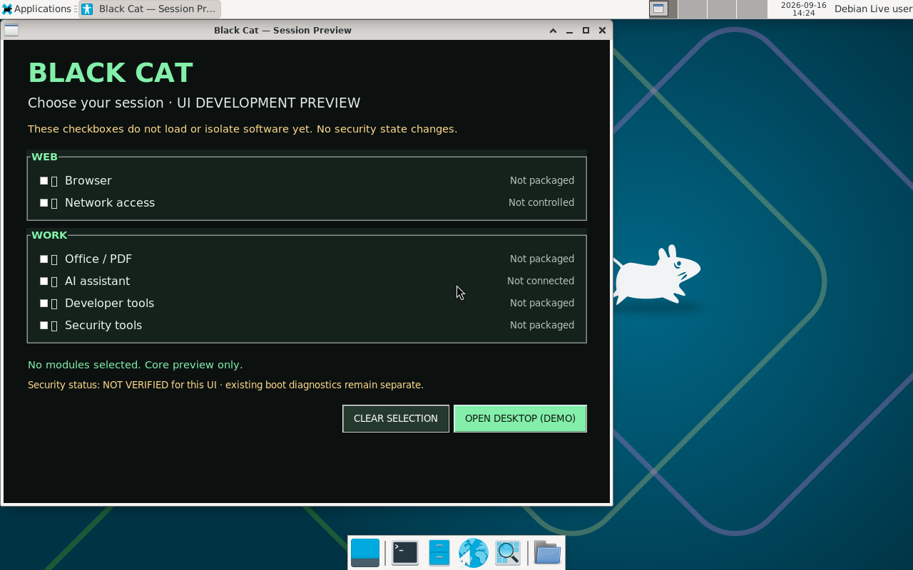
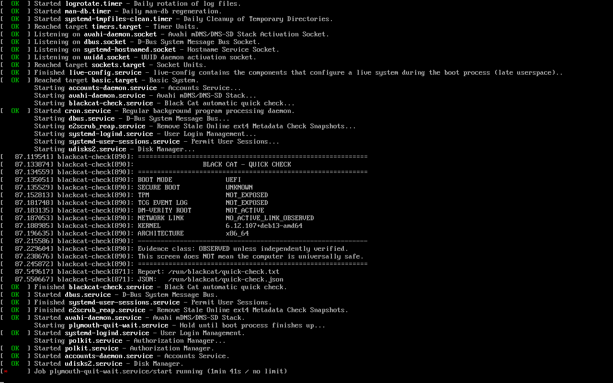

# Graphical candidate evidence and handoff — 16 September 2026

## What is established

The preserved development ISO was rehashed and booted in two separate UEFI virtual-machine sessions on the existing builder. The actual Xfce desktop and Black Cat session panel were observed. The alternate System Check entry produced the Quick Check report. These are scoped **OBSERVED** results, not release approval or hardware attestation.

| Identity | Value |
| --- | --- |
| Source commit | `86ddbb8eac1a0dbf912c035d5b916b70453dff88` |
| Filename | `live-image-amd64.hybrid.iso` |
| Exact size | `770703360` bytes |
| SHA-256 | `81f702cd9e59d4d7ba5654e6a69dbd655617968f92381049881930aef9b2fcb7` |
| Original construction | [run 35095923202](https://github.com/efrgdgr0024345/portable-trusted-linux/actions/runs/35095923202) |
| Recovered-copy identity check | [run 35107102698](https://github.com/efrgdgr0024345/portable-trusted-linux/actions/runs/35107102698) |
| VM observation | [run 35107884622](https://github.com/efrgdgr0024345/portable-trusted-linux/actions/runs/35107884622) |
| Test harness revision | `bf731270592334820fb6d782a79b91cb93572e5a` |
| Builder recovery copy | `/home/github-runner/blackcat-builds/run-35095923202-attempt-1/live-image-amd64.hybrid.iso` |
| Detailed report | [report.json](../evidence/2026-09-16-graphical/report.json) |

The original GitHub artifact upload failed because storage quota was exhausted. Recovery used the existing builder copy. A repeated digest on that builder is corroboration against prior CI logs, not independent authenticated build provenance.

## Screens inspected

The panel autostarted and its preview/NOT VERIFIED labels are visible. Some icon glyphs are missing. No checkbox or close-to-desktop interaction was performed by this test.

The root service produced a report. At this capture, `plymouth-quit-wait.service` was still running; the clean login/photo screen had not been established. The report says Secure Boot UNKNOWN, TPM/event log NOT_EXPOSED and dm-verity NOT_ACTIVE. Do not call these security properties verified.

## Remaining bounded work

1. Reuse this exact image and extend `tests/03-existing-candidate-boot.py` to exercise one checkbox, CLEAR SELECTION, and OPEN DESKTOP. Capture before/after evidence; require the summary and desktop state to change as expected.
2. Extend the separate System Check observation to a bounded settling timeout. Require the final photo prompt; diagnose the Plymouth wait if it does not settle. Preserve failure evidence instead of treating the early report marker as a complete pass.
3. Only if a source defect is confirmed, fix it, retain the old evidence and build a new explicitly identified candidate. A fix or new artwork changes the source/image and invalidates automatic transfer of prior boot evidence.
4. Arrange authenticated transfer of the exact candidate for a spare-USB physical test once the automated gates pass. Do not expose a new public server to avoid the artifact quota.

This work can be executed by a lighter coding model using the checkpoint. Escalate materially new trust/signing decisions for deliberate review; do not reopen the architecture or start the compute/blockchain tracks.

## Integration and design boundaries

The review branch `codex/graphical-evidence-review` preserves both the USB development branch and main's Console/Focus history through a merge commit on the review branch. Main itself has not been merged or overwritten. Old PRs and branches remain intact.

The user's [canonical design folder](../design/README.md) is now under `linux usb project`; the repository stores an inventory, unchanged brand notes and unchanged original cat reference. The existing ISO predates this integration. It does not implement the supplied welcome-screen design.

The prepared viewer reads reconciled main and displays capability evidence instead of a percentage. Deploy only after approved integration, with the existing rollback/token/verification safeguards. No production viewer or Console deployment occurred here.

## Known harness and source-check findings

- Two early VM attempts failed before guest boot while task-local graphics firmware paths were unresolved. The explicit SeaBIOS VGA ROM path fixed the harness without changing the ISO.
- Static checks falsely treated a comment naming the collector as collector execution and expected stale manifesto wording. Full-line comments are now ignored by that check; the policy wording check matches the actual existing policy.
- Signing tools required an executable shared validator, but its tracked mode was `100644`. The review branch restores `100755` without changing its cryptographic logic.
- PHP lint and viewer fixtures cover escaped capability text, status visibility, disabled/unavailable releases and fail-closed data failure. Source checks are separate from VM evidence and are attached to their own commits/runs.

## Stop boundaries

Physical device writes, production key custody, firmware/TPM changes, merge into main and approved-release promotion retain the existing human gates in `AI_AUTONOMY_POLICY.md`. An instruction to use a lighter model is not authorization to cross them.

## Source validation checkpoint

[Integration Source Checks run 35155024291](https://github.com/efrgdgr0024345/portable-trusted-linux/actions/runs/35155024291) passed at `a1a9afc3d2fba6d5c81ace22019493f4a951ec32`: repository static guards, valid and deliberately invalid signing cases, GUI source checks, Console/Focus static checks, PHP 8.4.24 lint and viewer escaping/status/fail-closed fixtures. These tests do not exercise a real API, production PHP 8.1 hosting or a phone. Later documentation/index commits must inspect their own source-check results.

The architecture review and bounded handoff are ready. The full product and the graphical physical-test milestone are not complete. Begin at `AI_WORK_STATE.md`.
